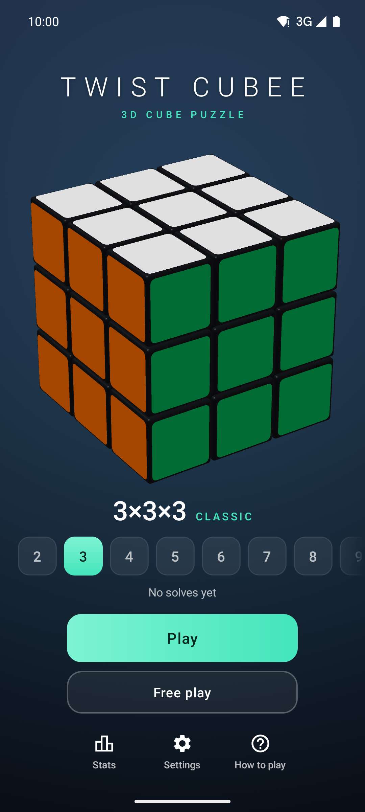
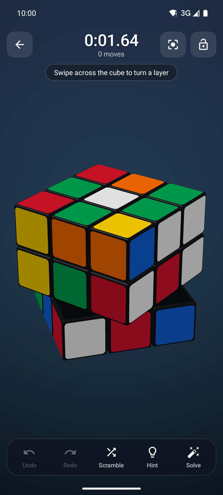
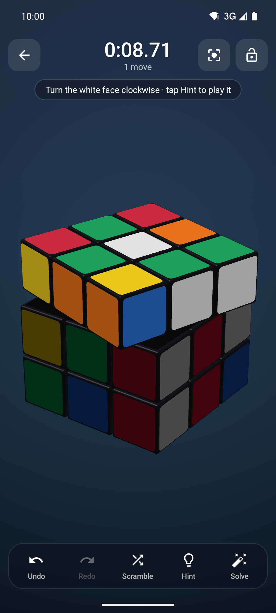
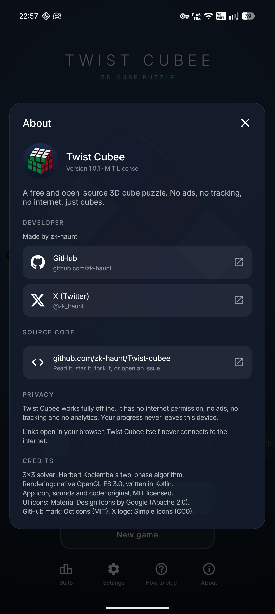

# Twist Cubee

**A fast, private, open-source 3D cube puzzle for Android.** Cubes from 2×2×2 to 20×20×20,
a real solver, speedcubing timer and statistics, in an app under 300 KB that never touches the internet.

<p>
  
  
  
  
</p>

## Features

- **Every size from 2×2×2 to 20×20×20.** Each size keeps its own saved game.
- **Natural controls:**
  - Drag across the cube to turn a layer; the sticker under your finger follows it, and a flick finishes the turn.
  - Drag the background, or use two fingers anywhere, to rotate freely with inertia.
  - Pinch to zoom, twist to roll, double-tap to reset the view.
  - A lock button prevents accidental rotation.
- **Speedcubing:**
  - An animated scramble, then a timer that starts on your first move.
  - Optional 15-second WCA-style inspection.
  - Per-size statistics: best, average, Ao5, fewest moves and recent solves.
- **Hints in plain words** on 2×2 and 3×3, e.g. *"Turn the green face clockwise"*. The layer to turn glows and wiggles.
- **Auto-solve:**
  - 2×2: optimal, from a full 3.6M-state table.
  - 3×3: Kociemba's two-phase algorithm, about 20 moves.
  - Larger cubes: rewinds your move history.
- **Customization:**
  - Stickerless or classic stickers, 4 color schemes (one color-blind friendly), 3 body colors and 4 backgrounds.
  - Animation speed, sound and haptics.
- **Polish:**
  - Portrait and landscape layouts, edge-to-edge UI, predictive back.
  - Undo/redo, and autosave that survives crashes.
  - An About page with links to the developer's GitHub and X, and to the source code.

## Privacy

Twist Cubee is private by design:

- The manifest explicitly **removes the `INTERNET` permission**, so the app cannot open a network connection. The release APK declares no permissions at all.
- There are no ads, trackers, analytics or crash reporters. The app has **zero third-party libraries**; only the Kotlin standard library is bundled.
- Progress and statistics stay on the device. They are excluded from cloud backups; only a direct device-to-device transfer to a new phone is allowed.
- No opaque dependency-metadata blob is embedded in the APK or AAB.

## Building

Requirements: JDK 17+ and the Android SDK (platform 36). Android Studio works out of the box.

```bash
./gradlew installDebug          # build + install on a connected device (USB debugging on)
./gradlew testDebugUnitTest     # cube model and solver tests
./gradlew assembleRelease       # minified APK -> app/build/outputs/apk/release/
./gradlew bundleRelease         # AAB for Google Play
```

Outside Android Studio, point Gradle at your SDK with `ANDROID_HOME`, or with a `local.properties`
file containing `sdk.dir=/path/to/Android/Sdk`. That file is git-ignored.

### Signing releases

1. Copy `keystore.properties.example` to `keystore.properties` and fill in your keystore details.
   Both that file and `*.jks` keystores are git-ignored, so your keys never end up in the repository.
2. Run `./gradlew assembleRelease` (or `bundleRelease`).

Without `keystore.properties`, release builds come out unsigned
(`app-release-unsigned.apk`). That's what F-Droid expects, because it signs its own builds. To try the
app locally without a key, use `./gradlew installDebug`.

### Regenerating artwork and sounds

The launcher icon, store icon and sound effects are generated from code, so the repository contains
no third-party assets:

```bash
python3 tools/generate_assets.py   # needs numpy
```

## How it stays fast

| Area | What the app does |
| --- | --- |
| Draw calls | Constant regardless of cube size. One instanced call draws every cubie, one draws every sticker, plus the background and 1–3 core boxes. |
| Layer turns | Animated entirely in the vertex shader, so a turn uploads **zero** buffer data per frame. |
| After a move | Only sticker colors are uploaded: 4 bytes per sticker, under 10 KB even on 20×20. |
| Idle | Frames render only while something moves (`RENDERMODE_WHEN_DIRTY`). An idle game uses no GPU, and the menu turntable stops after 25 s. |
| Garbage collection | The render loop, touch handling and move queue never allocate. Moves are packed `Int`s and math uses preallocated arrays. |
| Level of detail | Bevel tessellation drops with cube size: about 1,450 triangles per cubie on small cubes, 108 on large ones. |
| Mobile GPUs | 4× MSAA with fallbacks. The depth buffer is invalidated after each frame, and the GL context survives pause and rotation. |
| Solver | Tables are built once on a low-priority background thread, prewarmed while you are in the menu. |
| Size | No AndroidX, Compose or other libraries; R8 and resource shrinking give an APK under 300 KB. |

## Project layout

```
app/src/main/java/app/twistcubee/
  MainActivity.kt        UI layers (menu, HUD, panels), lifecycle, insets, back handling
  CubeView.kt            GLSurfaceView: render-on-demand, touch forwarding
  game/CubeGame.kt       gestures, animation, move queue, history, timer, inspection, hints
  game/Camera.kt         off-axis perspective that fits the cube into the free screen area
  render/                instanced GLES 3.0 renderer, shaders, procedural meshes
  model/                 NxN sticker model, packed moves + notation, scrambler
  solver/                Kociemba two-phase (3×3), optimal 2×2, background SolverService
  data/                  saves, statistics, settings, palettes
  ui/                    timer, confetti, palette swatch, sound effects
fastlane/metadata/       store listing text, icon and screenshots (read by F-Droid)
tools/                   asset generator
```

## Ideas for contributors

- More puzzles: Pyraminx, Megaminx, cuboids (2×2×3, 3×3×4…).
- A reduction solver for 4×4 and larger.
- Solve replays, a daily scramble, and keyboard controls for tablets and Chromebooks.
- Translations: all user-facing text is in `app/src/main/res/values/strings.xml`.

## Acknowledgements

The 3×3 solver implements [Herbert Kociemba's two-phase algorithm](https://kociemba.org/cube.htm).
Its coordinate definitions follow his description of the method.

## Third-party assets

The app has no third-party code libraries, but it uses a few third-party vector icons:

| Asset | Files | Source | License |
| --- | --- | --- | --- |
| UI icons (undo, redo, settings, hint…) | `app/src/main/res/drawable/ic_*.xml` (except the two below) | [Material Design Icons](https://github.com/google/material-design-icons) by Google | [Apache License 2.0](https://www.apache.org/licenses/LICENSE-2.0) |
| GitHub mark | `ic_github.xml` | [Octicons](https://github.com/primer/octicons) by GitHub | MIT |
| X logo | `ic_x.xml` | [Simple Icons](https://simpleicons.org) | CC0 1.0 |

The GitHub and X logos are trademarks of their owners and are used only to link to the developer's
profiles. The launcher icon, sound effects and all source code are original and MIT licensed.

## License

Twist Cubee is released under the [MIT License](LICENSE).
